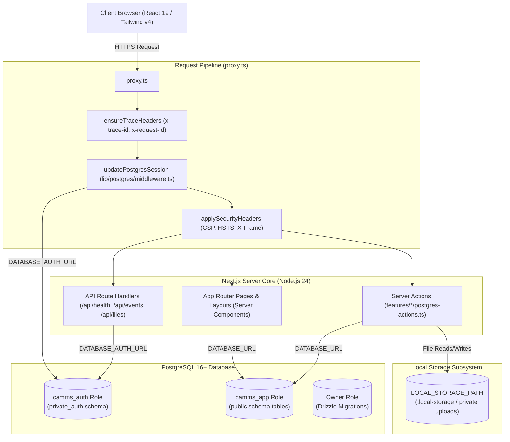
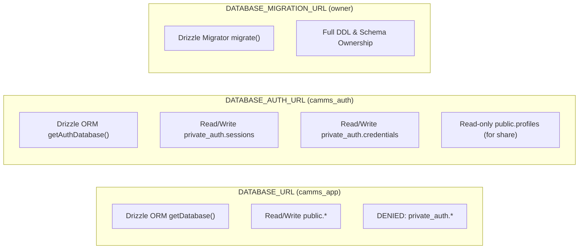
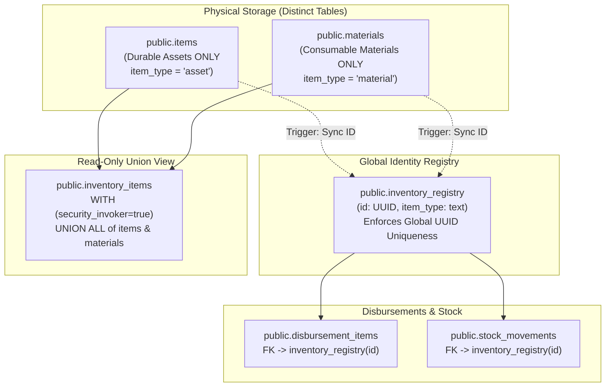

# CAMMS Architecture Documentation

> **Document Version:** 1.0.0 (PostgreSQL Native Architecture)  
> **Last Verified:** November 2026

---

## 1. System Architecture Overview

CAMMS is built on **Next.js 16 (App Router)** and **PostgreSQL 16+**, structured around strict domain separation, restricted database roles, and server-side state security.



---

## 2. Request Lifecycle & Middleware (`proxy.ts`)

In Next.js 16, the entry point for custom network interception is [proxy.ts](file:///D:/Center-Asset-Material-Management-System-main/proxy.ts):

1. **Distributed Tracing Header Injection ([lib/tracing.ts](file:///D:/Center-Asset-Material-Management-System-main/lib/tracing.ts)):**
   - Automatically ensures `x-request-id`, `x-correlation-id`, and `x-trace-id` headers exist on every incoming request.
2. **PostgreSQL Session Validation ([lib/postgres/middleware.ts](file:///D:/Center-Asset-Material-Management-System-main/lib/postgres/middleware.ts)):**
   - Extracts `camms_session` cookie (64-character hex string).
   - Hashes the token via SHA-256 (`tokenHash`) and verifies active session in `private_auth.sessions` joined with `public.profiles`.
   - Handles public exceptions: static assets, `/api/` paths, and public QR inspect route `/items/[uuid]`.
   - Handles idle timeout and explicit logout parameters (`reason=idle_timeout` or `logout=true`), deleting the database session and wiping the cookie.
   - Redirects unauthenticated traffic to `/login` with `Cache-Control: private, no-store`.
3. **Security Headers ([lib/security-headers.ts](file:///D:/Center-Asset-Material-Management-System-main/lib/security-headers.ts)):**
   - Injects Content Security Policy (CSP), Strict-Transport-Security (HSTS), X-Content-Type-Options: `nosniff`, X-Frame-Options: `DENY`, and X-Robots-Tag: `noindex, nofollow`.

---

## 3. Database Connection Architecture & Multi-Role Isolation

To prevent credential leaks and privilege escalation, CAMMS enforces connection pooling across three distinct database roles:



### Connection Configuration Details:
- **`camms_app` (`DATABASE_URL`):**
  - Application runtime role.
  - Possesses `SELECT`, `INSERT`, `UPDATE`, `DELETE` grants on business tables (`items`, `materials`, `disbursements`, etc.).
  - Has NO SELECT permission on `private_auth.credentials`.
- **`camms_auth` (`DATABASE_AUTH_URL`):**
  - Authentication and security role.
  - Used exclusively in [lib/postgres/session.ts](file:///D:/Center-Asset-Material-Management-System-main/lib/postgres/session.ts) and [features/auth/](file:///D:/Center-Asset-Material-Management-System-main/features/auth/).
  - Can read and update credentials, write sessions, and enforce login rate limits.
- **Session Identity Injection ([lib/postgres/db.ts](file:///D:/Center-Asset-Material-Management-System-main/lib/postgres/db.ts)):**
  - Every transaction executed through `withIdentity(userId, callback)` runs:
    ```sql
    SELECT set_config('app.user_id', ${userId}, true);
    ```
  - This informs database audit triggers and policies of the active authenticated user ID.

---

## 4. Physical Separation & Unified Read View Architecture

To satisfy Thai government regulations without duplicating logic or breaking foreign key integrity, the system implements a hybrid physical-relational design:



### Key Architectural Benefits:
1. **Physical Isolation:** `items` contains asset-specific fields (`depreciation_*`, `register_*`). `materials` contains Thai government stock ledger fields (`specification`, `commodity_code`, `opening_*`, `received_*`, `issued_*`).
2. **Referential Integrity:** `disbursement_items` and `stock_movements` reference `inventory_registry.id`. This avoids fragile dual-nullable foreign keys (`asset_id`, `material_id`) while allowing transactions to reference either inventory type.
3. **Read Optimization:** `public.inventory_items` provides a unified interface for full-text search, dashboard metrics, category aggregation, and government inventory reporting.

---

## 5. Private File Storage Architecture

Image handling avoids public object storage exposure:
1. **Client-Side Preparation ([lib/image-crop.ts](file:///D:/Center-Asset-Material-Management-System-main/lib/image-crop.ts)):**
   - Images are cropped to standard square/card ratios and compressed to WebP/JPEG using HTML5 Canvas before upload.
   - Max file size strictly enforced at 5 MB (`config.limits.imageMaxBytes`).
2. **Private Disk Storage ([lib/postgres/storage.ts](file:///D:/Center-Asset-Material-Management-System-main/lib/postgres/storage.ts)):**
   - Files are stored on host disk defined by `LOCAL_STORAGE_PATH` (defaults to `./.local-storage`).
   - File paths are organized as: `${storagePath}/item-images/${userId}/${imageId}.${ext}`.
3. **Authenticated Streaming ([app/api/files/[...path]/route.ts](file:///D:/Center-Asset-Material-Management-System-main/app/api/files/[...path]/route.ts)):**
   - File URLs are never served statically.
   - Requests to `/api/files/...` pass through session authentication.
   - Path traversal attacks (`..`, nul bytes, absolute paths) are explicitly rejected.
   - Verifies the image actually belongs to an existing inventory item in the database before streaming bytes.

---

## 6. Realtime Event Synchronization (SSE)

CAMMS features an in-house Server-Sent Events (SSE) bus for realtime screen updates:
- **Endpoint:** `/api/events?tables=items,materials,disbursements` ([app/api/events/route.ts](file:///D:/Center-Asset-Material-Management-System-main/app/api/events/route.ts))
- **Broadcasting Engine ([lib/postgres/events.ts](file:///D:/Center-Asset-Material-Management-System-main/lib/postgres/events.ts)):**
  - When mutations commit successfully, `broadcastTableChange(table, action, id)` notifies active client connections.
  - Client components use React hooks (`useLiveUpdates`) to trigger optimistic refresh or table revalidation without polling loops.

---

## 7. Model Context Protocol (MCP) Server Architecture

CAMMS contains a native STDIO Model Context Protocol (MCP) server for AI tool operations:
- **Entry Script:** [scripts/mcp-server.ts](file:///D:/Center-Asset-Material-Management-System-main/scripts/mcp-server.ts) & [scripts/mcp-postgres.ts](file:///D:/Center-Asset-Material-Management-System-main/scripts/mcp-postgres.ts)
- **Extensible Pipeline ([lib/tool-pipeline/](file:///D:/Center-Asset-Material-Management-System-main/lib/tool-pipeline/)):**
  - Tools: `list_items`, `get_item`, `create_item`, `update_item`, `delete_item`.
  - Security Guard: Read operations allowed with valid database credentials; write operations strictly blocked unless `CAMMS_MCP_ALLOW_WRITE=true` is explicitly provided.
