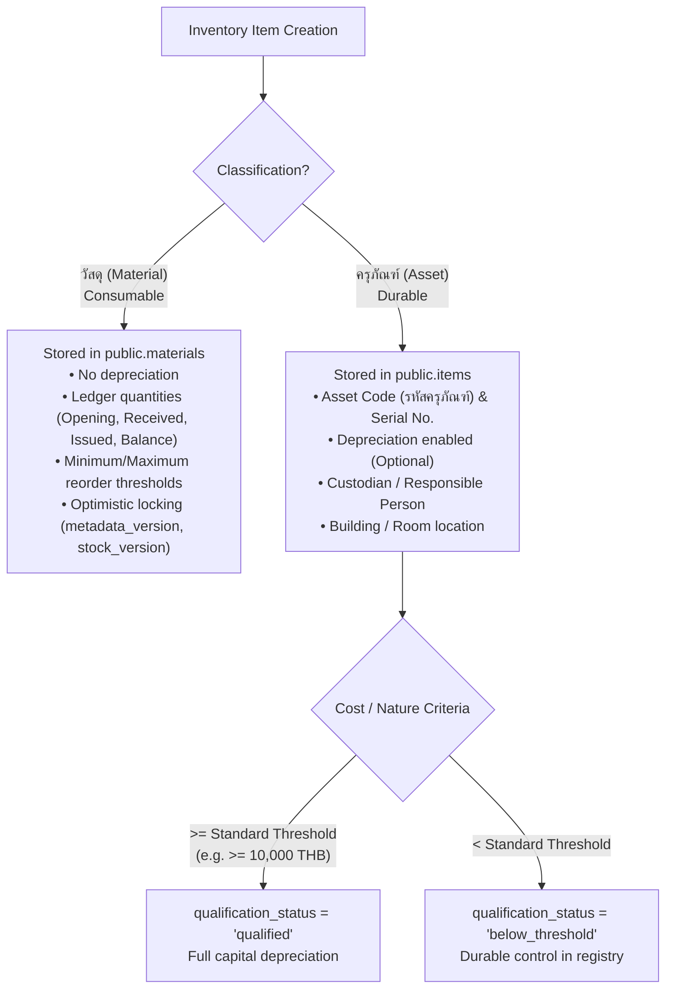

# CAMMS Business Rules & Domain Logic

> **Applicable Standard:** Ministry of Finance & Comptroller General's Department (Thailand)  
> **Source Verification:** [features/disbursements/](file:///D:/Center-Asset-Material-Management-System-main/features/disbursements/), [features/items/](file:///D:/Center-Asset-Material-Management-System-main/features/items/), [features/depreciation/](file:///D:/Center-Asset-Material-Management-System-main/features/depreciation/)  
> **Status:** Current operational business rules implemented in production code.

---

## 1. Inventory Classification Rules



### 1.1 Materials (วัสดุ)
- Must be assigned a Category with `item_type = 'material'`.
- `depreciation_enabled` must be `false` (enforced by DB check constraint `materials_depreciation_check`).
- Quantities must be non-negative integers (fractional units not supported in current database schema).
- Managed via dated ledger snapshots:
  $$\text{Balance Quantity} = \text{Opening Quantity} + \text{Received Quantity} - \text{Issued Quantity}$$
  $$\text{Balance Amount} = \text{Opening Amount} + \text{Received Amount} - \text{Issued Amount}$$

### 1.2 Assets (ครุภัณฑ์)
- Must be assigned a Category with `item_type = 'asset'`.
- Asset Number (`asset_no`) must be unique among active (non-deleted) items.
- Serial Number (`serial_no`) must be unique among active items.
- Soft delete rule: Deleting an asset sets `deleted_at = now()`, freeing the `asset_no` and `serial_no` for reassignment while preserving historical transactions.

---

## 2. Requisition & Disbursement Lifecycle

CAMMS supports three transaction types:
1. `material_issue` (การเบิกวัสดุ): Transfer of consumable goods from inventory.
2. `asset_handover` (การส่งมอบครุภัณฑ์): Permanent or long-term operational transfer of durable equipment.
3. `asset_borrow` (การยืมครุภัณฑ์): Temporary loan of durable equipment with an explicit return due date.

```mermaid
stateDiagram-v2
    [*] --> Draft: User/Admin creates draft
    Draft --> PendingApproval: submitPostgresDisbursementDraft()\n[Rule 0009: Deducts Material Stock Now]
    Draft --> Cancelled: cancelPostgresDisbursement() (No stock impact)
    
    PendingApproval --> Confirmed: confirmPostgresDisbursement()\n[Admin approves; stock already deducted]
    PendingApproval --> Rejected: rejectDisbursement()\n[Restores deducted stock]
    PendingApproval --> Cancelled: cancelPostgresDisbursement()\n[Restores deducted stock]
    
    Confirmed --> ActiveBorrow: (asset_borrow only)
    ActiveBorrow --> PartiallyReturned: Partial return accepted
    PartiallyReturned --> Returned: All items returned
    ActiveBorrow --> Returned: All items returned
    
    Confirmed --> Reversed: reversePostgresDisbursement()\n[Requires reason; restores stock / custody]
```



### 2.1 The "Immediate Stock Deduction" Rule (Rule 0009)
> [!IMPORTANT]
> In earlier design iterations, material requisitions used reservations (`reserved_quantity`). **This was formally deprecated and replaced by Rule 0009 ([0009_immediate_material_stock.sql](file:///D:/Center-Asset-Material-Management-System-main/db/postgres/migrations/0009_immediate_material_stock.sql)).**

1. **At `draft` state:** No stock is deducted or reserved.
2. **At `submit` (`draft` -> `pending_approval`):**
   - The system locks the material rows in primary-key order (`FOR UPDATE`).
   - Checks `quantity >= requested_qty`. If insufficient, throws error and rolls back.
   - **Immediately deducts physical stock** (`quantity = quantity - requested_qty`).
   - Creates an audit entry in `stock_movements` with `movement_type = 'issue'`.
3. **At `confirm` (`pending_approval` -> `confirmed`):**
   - Stock is **NOT** deducted again. The document status transitions to `confirmed`.
4. **At `cancel` or `reject` (`pending_approval` -> `cancelled` / `rejected`):**
   - The previously deducted stock is refunded (`quantity = quantity + requested_qty`).
   - Recorded in `stock_movements` with `movement_type = 'reversal'`.

### 2.2 Borrowing & Handover Constraints
- When `transaction_type = 'asset_borrow'`, `due_date` is strictly mandatory.
- A single asset (`asset_no`) cannot be concurrently loaned to multiple parties. Active borrowings (`status IN ('active_borrow', 'partially_returned')`) lock the item from new loan requisitions.
- Return condition tracking: Every returned item records condition as `'normal'`, `'damaged'`, or `'lost'` in `asset_custody_logs`.

---

## 3. Straight-Line Depreciation Engine

Assets with `depreciation_enabled = true` follow the Thai Comptroller General's Department straight-line method:

### 3.1 Formula
$$\text{Annual Depreciation} = \frac{\text{Depreciation Cost} - \text{Residual Value}}{\text{Useful Life Years}}$$
$$\text{Monthly Depreciation} = \frac{\text{Annual Depreciation}}{12}$$
$$\text{Daily Depreciation} = \frac{\text{Annual Depreciation}}{365}$$

### 3.2 Invariants
1. **Residual Value (มูลค่าซากคงเหลือ):** Must be exactly **1.00 THB** (`depreciation_residual_value = 1.00`), matching Thai public asset standards.
2. **Book Value Lower Bound:** Net book value cannot fall below 1.00 THB. Once total accumulated depreciation reaches $(\text{Cost} - 1)$, depreciation halts.
3. **Start Basis:**
   - `'acquired'`: Starts calculating from `acquired_date`.
   - `'available'`: Starts calculating from the date placed in service.
   - `'manual'`: Custom date provided in `depreciation_start_date`.

---

## 4. Role-Based Access Control (RBAC) & Anti-Lockout

CAMMS implements two active application roles:
- **`admin` (ผู้ดูแลระบบ):**
  - Full CRUD on assets, materials, categories, locations, units.
  - Approve, reject, confirm, handover, return, and reverse all disbursements.
  - User account management, email updates, password resets.
  - Database table backup and atomic restore.
- **`user` (ผู้ใช้ทั่วไป):**
  - Read-only browsing of assets and materials.
  - Can create and submit `material_issue` drafts/requisitions.
  - CANNOT create asset handovers or asset loans.
  - CANNOT edit metadata, categories, or other users' profiles.

### 4.1 Anti-Lockout & Self-Protection Rules
Implemented in [features/admin/postgres-policy.ts](file:///D:/Center-Asset-Material-Management-System-main/features/admin/postgres-policy.ts):
1. **No Self-Demotion:** An admin cannot change their own role to `'user'`.
2. **No Self-Deactivation:** An admin cannot set their own `is_active` to `false`.
3. **No Self-Deletion:** An admin cannot delete their own profile.
4. **Last-Admin Protection:**
   - Any attempt to deactivate, demote, or delete an admin executes under a PostgreSQL advisory lock:
     ```sql
     SELECT pg_advisory_xact_lock(hashtext('camms_admin_protection'));
     ```
   - Checks the count of active administrators:
     $$\text{COUNT}(*) \text{ WHERE role = 'admin' AND is_active = true}$$
   - If count $\le 1$, the mutation is blocked with: `"ต้องมีผู้ดูแลระบบที่ใช้งานอยู่อย่างน้อย 1 คน"`.

---

## 5. Thai Language & Unicode Normalization Rules

To avoid search anomalies, duplicate keys, and broken ICU sorts:
1. **NFC Normalization:** All text inputs are converted to Unicode Normalization Form C (`String.prototype.normalize('NFC')`).
2. **Invisible Character Scrubbing ([lib/unicode.ts](file:///D:/Center-Asset-Material-Management-System-main/lib/unicode.ts)):**
   - Zero-width spaces (`\u200B`), zero-width joiners (`\u200D`), zero-width non-joiners (`\u200C`), and Byte Order Marks (`\uFEFF`) are removed prior to database insertion.
3. **Thai Dictionary Collation:**
   - Database queries sort Thai strings with `COLLATE "th-TH-x-icu"`.
   - This ensures correct Thai vowel/tone mark sorting according to Royal Institute dictionary rules (e.g., vowels like `เ-`, `แ-` correctly sort with their base consonants).
