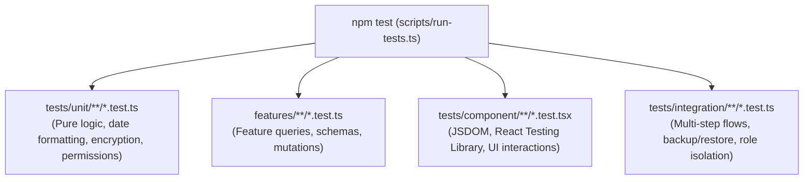

# CAMMS Development & Engineering Guidelines

> **Target Platform:** Node.js 24.x LTS (`engines: ">=24.0.0 <25"`), npm 11.14.1  
> **Framework:** Next.js 16 (App Router), React 19, Tailwind CSS v4

---

## 1. Local Environment Setup

### 1.1 Prerequisites
- **Node.js:** `v24.x` (Use [nvm](https://github.com/nvm-sh/nvm): `nvm use` reads `.nvmrc`).
- **npm:** `v11.14.1` (Pinned in `package.json`).
- **Docker Desktop:** Required for the local PostgreSQL 16 instance.

### 1.2 Starting PostgreSQL
CAMMS provisions isolated local database instances via Docker:
```bash
# Start local PostgreSQL container
npm run postgres:up

# Run migrations and setup restricted app & auth roles
npm run postgres:app:setup

# Verify connectivity
npm run postgres:test
```

### 1.3 Running the Development Server
```bash
npm run dev
```
Access the application at `http://localhost:3000`.

---

## 2. Coding Standards & Conventions

### 2.1 Next.js 16 & React 19 Rules
1. **Server Components by Default:**
   - Pages (`page.tsx`), layouts (`layout.tsx`), and data-fetching components are Server Components.
   - Do NOT add `'use client'` unless the component requires event listeners (`onClick`), browser hooks (`useState`, `useEffect`), or DOM manipulation.
2. **Server-Only Boundaries:**
   - All backend database files, queries, password utilities, and session managers MUST import `'server-only'` on line 1:
     ```typescript
     import 'server-only'
     ```
   - This ensures sensitive database queries or restricted credentials cannot accidentally be bundled into client bundles.
3. **Server Actions Convention:**
   - Server Actions must declare `'use server'` at the file or function level.
   - Never expose raw SQL errors, stack traces, or password hashes to the client. Use `toSafeErrorMessage(err)` from [lib/errors.ts](file:///D:/Center-Asset-Material-Management-System-main/lib/errors.ts).

### 2.2 TypeScript & Linting
- **Strict Mode:** `tsconfig.json` has `strict: true`, `noImplicitAny: true`.
- **No Unused Code:** `tsc` enforces `--noUnusedLocals` and `--noUnusedParameters`.
- **Lint Enforcement:** ESLint 9 Flat Config (`eslint.config.mjs`) forbids `@typescript-eslint/no-explicit-any`. Always type inputs with explicit interfaces or Zod schemas.

### 2.3 Tailwind CSS v4 & Styling Guidelines
- **Theme Variables:** Defined in [app/globals.css](file:///D:/Center-Asset-Material-Management-System-main/app/globals.css) using CSS custom properties (`--background`, `--foreground`, `--primary`, `--muted`, `--destructive`, `--border`).
- **NO Hardcoded Colors:** Never use raw hex colors or arbitrary color classes (e.g. `text-slate-800`, `bg-[#1a202c]`). Always use semantic Tailwind tokens (`text-foreground`, `bg-muted`, `border-border`).
- **Dark Mode Support:** All components must render cleanly in both light and dark mode (`.dark` / `[data-theme="dark"]`).

### 2.4 Thai Language & Typography
- **Typography:**
  - Thai body text and headings: *Sarabun*.
  - Numbers, codes, and English labels: *Capriola*.
- **Numbers:** Always use `tabular-nums` for numeric figures in tables and stat cards to ensure vertical alignment.
- **Thai Collation:** When constructing SQL queries sorting by Thai names, append `COLLATE "th-TH-x-icu"`.

---

## 3. Testing Infrastructure

CAMMS enforces rigorous test coverage across 232+ test files using the native Node.js test runner and tsx.



### 3.1 Running Tests
```bash
# Run full unit and component test suite
npm test

# Run a specific test file
node --import tsx --test tests/component/items-list-row.test.tsx

# Run with test coverage
npm run test:coverage
```

### 3.2 Component Testing Rules (JSDOM)
- Component tests import [tests/setup/dom.ts](file:///D:/Center-Asset-Material-Management-System-main/tests/setup/dom.ts).
- `globalThis.React = React` is configured globally to support tsx JSX transforms.
- JSDOM primitives (`ResizeObserver`, `IntersectionObserver`, `HTMLDialogElement.prototype.showModal`, `FileReader`, `Image`) are pre-mocked in `dom.ts`.
- When testing table rows, always provide `userCanWrite={true}` if asserting on selection checkboxes.

### 3.3 Live Database Integration Tests
Live tests against actual PostgreSQL instances are opt-in to avoid blocking headless environments:
- `POSTGRES_QUERY_INTEGRATION=1`: Runs [features/items/postgres-queries-live.test.ts](file:///D:/Center-Asset-Material-Management-System-main/features/items/postgres-queries-live.test.ts).
- `POSTGRES_ADMIN_LIVE_TEST=1`: Runs [tests/integration/postgres-admin-restore-live.test.ts](file:///D:/Center-Asset-Material-Management-System-main/tests/integration/postgres-admin-restore-live.test.ts).
- In GitHub CI, these run against the official PostgreSQL 16 GitHub service container.

---

## 4. Pre-Commit & Verification Loop

Before committing any changes or creating a Pull Request, agents and developers **MUST** run and pass the following quality gates:

```bash
# 1. Lint check (must pass with 0 errors)
npm run lint

# 2. TypeScript type check (must pass with 0 errors)
npm run typecheck

# 3. Full test suite (all test files must pass)
npm test
```
