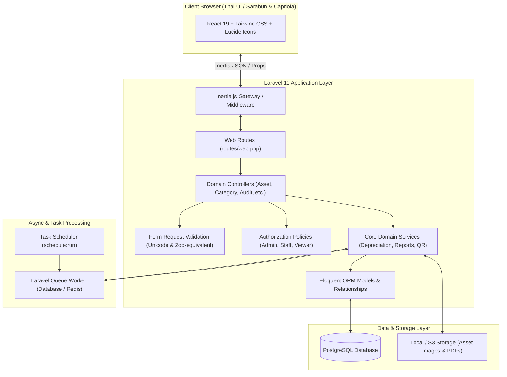
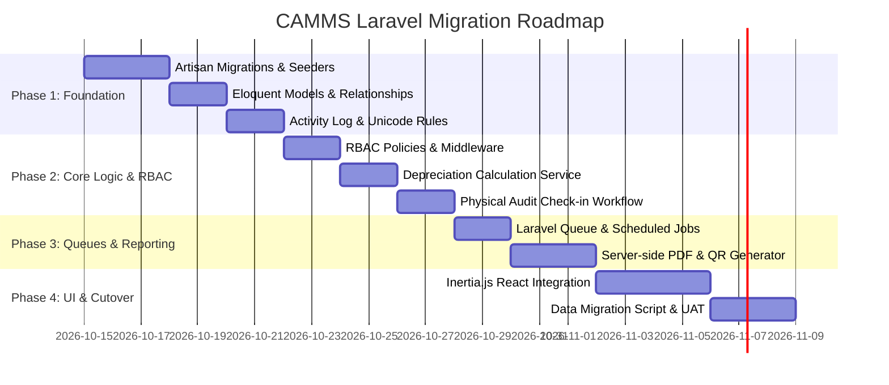

# CAMMS — Laravel Architecture & Migration Design

**Date:** 2026-10-14  
**Status:** Proposed Spec  
**Target Stack:** Laravel 11.x + Inertia.js (React 19) + PostgreSQL  
**Document Path:** `docs/superpowers/specs/2026-10-14-laravel-migration-design.md`

---

## 1. Executive Summary & Objective

**Center Asset & Material Management System (CAMMS)** is currently built on Next.js 16 (React 19), PostgreSQL (Supabase / standalone Docker + Drizzle ORM), Thai-first typography (Sarabun & Capriola), and custom audit/mutation pipelines.

The objective of this design is to establish a robust, maintainable, and enterprise-grade **Laravel Monolith with Inertia.js (React)** architecture. This enables:
1. **Built-in Async Queues & Schedulers:** Robust background processing for annual depreciation calculation and bulk Excel/PDF generation.
2. **Standardized Database Lifecycle:** Native Artisan migrations, transactional schema updates, rollbacks, and Eloquent ORM.
3. **Automated Audit Logging:** Automatic model-level change tracking (`old` vs `new`) via `spatie/laravel-activitylog`.
4. **Preserved UI/UX Investment:** Direct reuse of existing React 19 components, Tailwind CSS styling, Thai collation, and font tokens via Inertia.js.
5. **Clear Enterprise RBAC:** Granular Gates/Policies enforcing CAMMS's strict permissions rules (Admin, Staff, Viewer).

---

## 2. System Architecture



---

## 3. Database Schema & Eloquent Models

### 3.1 Migration Strategy
All migrations will be authored in standard Laravel Artisan format, targeting PostgreSQL with ICU Thai collation (`th-TH-x-icu`).

### 3.2 Key Models & Relationships

| Model | Table | Traits & Features | Primary Relationships |
|---|---|---|---|
| `User` | `users` | Authenticatable, HasRoles | `hasMany(AuditLog)` |
| `Asset` | `assets` | `SoftDeletes`, `LogsActivity` | `belongsTo(Category)`, `belongsTo(Location)`, `belongsTo(Unit)`, `hasMany(AuditCheck)` |
| `Category` | `categories` | `LogsActivity` | `hasMany(Asset)` |
| `Location` | `locations` | `LogsActivity` | `hasMany(Asset)` |
| `Unit` | `units` | `LogsActivity` | `hasMany(Asset)` |
| `DepreciationRecord` | `depreciation_records` | Immutable log | `belongsTo(Asset)` |
| `AuditCheck` | `audit_checks` | Physical audit check-in | `belongsTo(Asset)`, `belongsTo(User)` |
| `Activity` | `activity_log` | Spatie Activity Log | `morphTo(subject)`, `belongsTo(causer)` |

### 3.3 Strict Hard Boundaries (Compliance)
- **Soft Deletes on Assets:** Deleting an asset never permanently drops records from the database (`deleted_at` timestamp used).
- **Admin Self-Protection:** A policy check guarantees an Admin cannot demote, deactivate, or delete themselves, and there must always be $\ge 1$ active Admin in the system.

---

## 4. Role-Based Access Control (RBAC) & Security

Laravel Policies enforce the hard-boundary RBAC table:

| Role | Browse & Reports | Create / Edit Items | Physical Audit Check-in | Delete Items | User Management & DB Tools |
|---|:---:|:---:|:---:|:---:|:---:|
| **Admin** | ✅ | ✅ | ✅ | ✅ | ✅ |
| **Staff** | ✅ | ✅ | ✅ | ❌ | ❌ |
| **Viewer** | ✅ | ❌ | ❌ | ❌ | ❌ |

### Implementation Pattern (Policy Example)
```php
namespace App\Policies;

use App\Models\User;
use App\Models\Asset;

class AssetPolicy
{
    public function viewAny(User $user): bool {
        return true; // All authenticated roles can view
    }

    public function create(User $user): bool {
        return in_array($user->role, ['admin', 'staff'], true);
    }

    public function update(User $user, Asset $asset): bool {
        return in_array($user->role, ['admin', 'staff'], true);
    }

    public function delete(User $user, Asset $asset): bool {
        // Hard Rule: Only Admin can delete assets
        return $user->role === 'admin';
    }
}
```

---

## 5. Depreciation Calculation & Fiscal Year Automation

### 5.1 Formula Preservation (Straight-Line & Declining Balance)
The exact formula currently in CAMMS is ported directly into `App\Services\DepreciationCalculatorService`:
$$\text{Annual Depreciation} = \frac{\text{Cost} - \text{Salvage Value}}{\text{Useful Life (Years)}}$$
$$\text{Depreciation per Day} = \frac{\text{Annual Depreciation}}{365}$$

### 5.2 Scheduled Job
A Laravel Scheduled Task runs at the end of each Thai Fiscal Year (September 30th):
```php
// routes/console.php
Schedule::job(new CalculateFiscalYearDepreciationJob)->yearlyOn(9, 30, '23:59');
```

---

## 6. Audit Trail & Compliance

Using `spatie/laravel-activitylog`:
1. **Automatic Capture:** All changes to `Asset`, `Category`, `Location`, and `User` are recorded with old vs new attributes in JSON.
2. **Actor Attribution:** Every mutation logs the acting user's ID, IP address, and User-Agent.
3. **Immutability:** Audit log tables are append-only. No user (including Admin) can edit or delete audit trail records.

---

## 7. Reporting & Label Printing

1. **PDF Generation (Server-Side):**
   - Use `barryvdh/laravel-snappy` or `spatie/browsershot` for pixel-perfect PDF rendering of official Thai government asset forms (พด. 1, พด. 2).
   - Fonts: Embedded Sarabun font guarantees identical rendering across all client devices.
2. **QR Code / Asset Tag Printing:**
   - Use `simplesoftwareio/simple-qrcode` to generate QR codes with asset numbers, serial numbers, and direct inspection URLs.
   - Dual-layout support: Standard A4 sticker sheet and Thermal Roll printers.
3. **Large Excel Export/Import:**
   - Handled via `maatwebsite/excel` with queued chunked imports and exports.

---

## 8. Implementation Roadmap (Phased Execution)



### Self-Review Checklist
- [x] **No Placeholders:** All sections define concrete classes, relationships, and behaviors.
- [x] **Consistency:** Adheres strictly to CAMMS Thai-first UI, RBAC limits, and depreciation rules.
- [x] **Scope:** Monolithic Inertia.js architecture preserves existing React components without rewriting UI from scratch.
- [x] **Clarity:** Explicit boundary between Admin, Staff, and Viewer roles.
