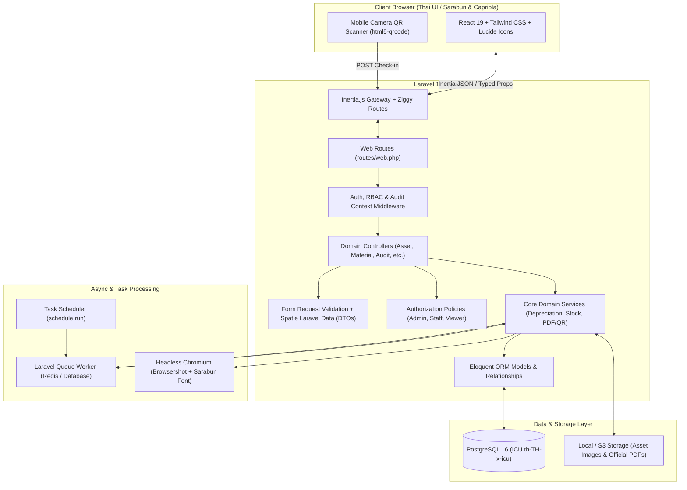
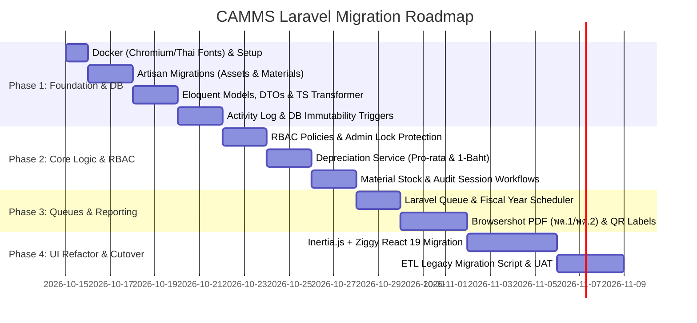

# CAMMS — Laravel Architecture & Migration Design

**Date:** 2026-10-14  
**Status:** Approved Spec (Complete Edition)  
**Target Stack:** Laravel 11.x + Inertia.js (React 19 + TypeScript) + PostgreSQL 16  
**Document Path:** `docs/superpowers/specs/2026-10-14-laravel-migration-design.md`

---

## 1. Executive Summary & Objective

**Center Asset & Material Management System (CAMMS)** is currently built on Next.js 16 (React 19), PostgreSQL (Supabase / standalone Docker + Drizzle ORM), Thai-first typography (Sarabun & Capriola), and custom audit/mutation pipelines.

The objective of this design is to establish a robust, maintainable, and enterprise-grade **Laravel Monolith with Inertia.js (React)** architecture covering both **Durable Assets (ครุภัณฑ์)** and **Consumable Materials (วัสดุสิ้นเปลือง)**. This enables:
1. **Built-in Async Queues & Schedulers:** Robust background processing for annual depreciation calculation, low-stock alerts, and bulk Excel/PDF generation.
2. **Standardized Database Lifecycle:** Native Artisan migrations, transactional schema updates, partial unique indexes, DB-level immutability triggers, and Eloquent ORM.
3. **Automated Audit Logging:** Automatic model-level change tracking (`old` vs `new`) with IP and User-Agent attribution via `spatie/laravel-activitylog`.
4. **Preserved UI/UX & Type Safety:** Direct reuse of existing React 19 components, Tailwind CSS styling, Thai collation, and end-to-end TypeScript safety via `spatie/laravel-data` and `tightenco/ziggy`.
5. **Clear Enterprise RBAC:** Granular Gates/Policies enforcing CAMMS's strict permissions rules (Admin, Staff, Viewer) with concurrency-safe Admin self-protection.

---

## 2. System Architecture



---

## 3. Database Schema & Eloquent Models

### 3.1 Migration & Indexing Strategy
All migrations will be authored in standard Laravel Artisan format, targeting PostgreSQL 16 with ICU Thai collation (`th-TH-x-icu`):
- **Financial & Quantity Precision:** All monetary columns (`cost`, `salvage_value`, `accumulated_depreciation`, `net_book_value`, `unit_price`) MUST use `DECIMAL(15, 2)`. Floating-point types (`FLOAT`, `DOUBLE`) are strictly prohibited.
- **Soft Deletes & Partial Unique Indexes:** Because `assets` and `materials` use `SoftDeletes`, standard unique constraints on `asset_code` or `sku` would block reusing codes of deleted records. Migrations must define PostgreSQL partial unique indexes:
  ```sql
  CREATE UNIQUE INDEX assets_asset_code_unique_active ON assets (asset_code) WHERE deleted_at IS NULL;
  CREATE UNIQUE INDEX materials_sku_unique_active ON materials (sku) WHERE deleted_at IS NULL;
  ```

### 3.2 Key Models & Relationships (Assets & Materials)

| Model | Table | Traits & Features | Primary Relationships |
|---|---|---|---|
| `User` | `users` | `Authenticatable`, `LogsActivity` | `hasMany(AuditCheck)`, `hasMany(StockTransaction)` |
| `Category` | `categories` | `LogsActivity` (Type: `asset` \| `material`) | `hasMany(Asset)`, `hasMany(Material)` |
| `Location` | `locations` | `LogsActivity` | `hasMany(Asset)`, `hasMany(Material)` |
| `Unit` | `units` | `LogsActivity` | `hasMany(Asset)`, `hasMany(Material)` |
| `Asset` | `assets` | `SoftDeletes`, `LogsActivity` | `belongsTo(Category)`, `belongsTo(Location)`, `belongsTo(Unit)`, `hasMany(DepreciationRecord)`, `hasMany(AuditCheck)` |
| `DepreciationRecord` | `depreciation_records` | Immutable log (`DECIMAL(15,2)`) | `belongsTo(Asset)` |
| `AuditSession` | `audit_sessions` | `LogsActivity` (Fiscal Year inspection cycle) | `hasMany(AuditCheck)`, `belongsTo(User, 'created_by')` |
| `AuditCheck` | `audit_checks` | Unique per `(audit_session_id, asset_id)` | `belongsTo(AuditSession)`, `belongsTo(Asset)`, `belongsTo(User, 'checked_by')` |
| `Material` | `materials` | `SoftDeletes`, `LogsActivity` (Consumables) | `belongsTo(Category)`, `belongsTo(Location)`, `belongsTo(Unit)`, `hasMany(StockTransaction)` |
| `StockTransaction` | `stock_transactions` | Immutable inventory ledger (`IN`, `OUT`, `ADJUST`) | `belongsTo(Material)`, `belongsTo(User)` |
| `Activity` | `activity_log` | Spatie Activity Log (Append-only) | `morphTo(subject)`, `belongsTo(causer)` |

### 3.3 Material Management (Consumables) Rules
- **Atomic Stock Movements:** `Material` stock levels (`current_quantity`) cannot be edited directly via CRUD forms. All changes must pass through `StockManagementService`, which wraps `StockTransaction` creation and `materials.current_quantity` updates inside a `DB::transaction()` with `lockForUpdate()` to prevent negative stock under concurrent requests.
- **Low-Stock Threshold:** Each `Material` defines a `min_stock_level`. When `current_quantity <= min_stock_level`, the dashboard highlights the item for reorder.

### 3.4 Strict Hard Boundaries & DB-Level Compliance
1. **Soft Deletes on Assets & Materials:** Deleting an item never permanently drops records from the database (`deleted_at` timestamp used). `forceDelete()` is disabled in all Policies.
2. **Concurrency-Safe Admin Self-Protection:**
   - An Admin cannot demote, deactivate, or delete themselves.
   - There must always be $\ge 1$ active Admin in the system.
   - Enforced inside `UserService` using `DB::transaction()` and `User::where('role', 'admin')->where('is_active', true)->lockForUpdate()->count()` to prevent race conditions when two Admins modify accounts simultaneously.
3. **Database-Level Immutability Triggers:** To guarantee compliance even against direct SQL mistakes, a PostgreSQL trigger blocks `UPDATE` and `DELETE` statements on `activity_log`, `depreciation_records`, and `stock_transactions`.

---

## 4. Role-Based Access Control (RBAC) & Security

Laravel Policies enforce the hard-boundary RBAC table across both Assets and Materials:

| Role | Browse & Reports | Create / Edit Items | Stock In/Out & Audit Check-in | Delete Items (Soft) | User Management & DB Tools |
|---|:---:|:---:|:---:|:---:|:---:|
| **Admin** | ✅ | ✅ | ✅ | ✅ | ✅ |
| **Staff** | ✅ | ✅ | ✅ | ❌ | ❌ |
| **Viewer** | ✅ | ❌ | ❌ | ❌ | ❌ |

### Implementation Pattern (Policy Example)
```php
namespace App\Policies;

use App\Models\User;
use App\Models\Asset;

class AssetPolicy
{
    public function viewAny(User $user): bool {
        return $user->is_active;
    }

    public function create(User $user): bool {
        return $user->is_active && in_array($user->role, ['admin', 'staff'], true);
    }

    public function update(User $user, Asset $asset): bool {
        return $user->is_active && in_array($user->role, ['admin', 'staff'], true);
    }

    public function delete(User $user, Asset $asset): bool {
        // Hard Rule: Only active Admin can soft-delete assets
        return $user->is_active && $user->role === 'admin';
    }

    public function forceDelete(User $user, Asset $asset): bool {
        // Hard Rule: Permanent deletion is strictly forbidden
        return false;
    }
}
```

---

## 5. Depreciation Calculation & Fiscal Year Automation

### 5.1 Formula & Thai Government Accounting Rules
`App\Services\DepreciationCalculatorService` uses PHP `bcmath` / `Brick\Money` for exact decimal arithmetic:

$$\text{Annual Depreciation} = \frac{\text{Cost} - \text{Salvage Value}}{\text{Useful Life (Years)}}$$

$$\text{First/Partial Year Depreciation (Pro-rata)} = \text{Annual Depreciation} \times \frac{\text{Days Held in Fiscal Year}}{\text{Days in Fiscal Year (365 or 366)}}$$

**Strict Accounting Rules:**
1. **Thai Fiscal Year Window:** Runs from **October 1st** to **September 30th** of the following year.
2. **Pro-rata Mid-Year Acquisition:** Assets acquired during the fiscal year are depreciated from `acquisition_date` through September 30th (inclusive).
3. **1-Baht Minimum Book Value Floor:** Once an asset reaches the end of its useful life, its Net Book Value (`net_book_value`) MUST be clamped to **`1.00 THB`** (never `0.00` or negative) while the asset remains active in inventory, adhering to Thai public-sector accounting standards.
4. **Idempotency:** Each `DepreciationRecord` is uniquely keyed by `(asset_id, fiscal_year)` (e.g., `2569`). Re-running the job for the same fiscal year safely skips or updates draft calculations without duplicating records.

### 5.2 Scheduled Job
A Laravel Scheduled Task runs at the end of each Thai Fiscal Year (September 30th):
```php
// routes/console.php
Schedule::job(new CalculateFiscalYearDepreciationJob(fiscalYear: now()->year + 543))
    ->yearlyOn(9, 30, '23:59')
    ->timezone('Asia/Bangkok')
    ->withoutOverlapping();
```

---

## 6. Audit Trail, Physical Audit Sessions & Compliance

### 6.1 System Mutation Logging (`spatie/laravel-activitylog`)
1. **Automatic Capture:** All changes to `Asset`, `Material`, `Category`, `Location`, `AuditSession`, and `User` record only dirty attributes (`logOnlyDirty()`) with old vs new JSON payloads.
2. **Actor & Request Attribution:** A global `CaptureAuditContextMiddleware` automatically injects `ip_address` and `user_agent` into the `properties` JSON column of every activity log entry.
3. **Immutability:** Enforced via both `ActivityPolicy` (read-only) and PostgreSQL `BEFORE UPDATE OR DELETE` trigger raising an exception.

### 6.2 Physical Audit Workflow (`AuditSession` & `AuditCheck`)
- **Session-Scoped Inspection:** Before annual physical check-ins begin, an Admin/Staff opens an `AuditSession` (e.g., `"การตรวจสอบพัสดุประจำปีงบประมาณ 2569"`, status: `open` | `closed`).
- **Duplicate Check-in Prevention:** `audit_checks` enforces a composite unique constraint `UNIQUE (audit_session_id, asset_id)`. Scanning an already-inspected asset displays its existing check-in status (`found`, `damaged`, `missing`, `relocated`) and allows updating remarks within the open session rather than creating duplicate rows.
- **Mobile & Scanner Support:** The Inertia inspection page supports both mobile camera QR scanning (`html5-qrcode`) and USB/Bluetooth HID barcode scanners.

---

## 7. Frontend Migration Strategy (Next.js 16 to Inertia.js React 19)

To preserve 100% of the visual design, Sarabun/Capriola typography, and React 19 components while eliminating Next.js App Router complexity:

| Concern | Legacy Next.js 16 Implementation | Target Laravel + Inertia.js Pattern |
|---|---|---|
| **Routing & Links** | `next/link`, `useRouter()`, `usePathname()` | `<Link>` and `router` from `@inertiajs/react` + Type-safe named routes via **`tightenco/ziggy`** (`route('assets.show', asset.id)`) |
| **Data Fetching** | React Server Components (RSC) / API Routes | Controller passes typed props via `Inertia::render('Assets/Index', [...])` |
| **Mutations & Forms** | Next.js Server Actions + Zod | Inertia `useForm()` hook bound to Laravel `FormRequest` validation; errors automatically populate `form.errors` |
| **End-to-End TypeScript** | Drizzle ORM inferred types | **`spatie/laravel-data`** + **`spatie/laravel-typescript-transformer`** auto-generates `resources/js/types/generated.d.ts` |
| **Shared UI State** | Custom Context / Middleware fetches | `HandleInertiaRequests` middleware shares `auth.user`, `permissions`, `flash` messages, and `activeAuditSession` globally |

---

## 8. Reporting, Label Printing & Docker Infrastructure

1. **PDF Generation (Server-Side via Browsershot):**
   - Standardize on **`spatie/browsershot`** (Headless Chromium) instead of legacy `wkhtmltopdf` to guarantee accurate Thai vowel/tone-mark positioning (`สระลอย/วรรณยุกต์ซ้อน`) and modern CSS Grid/Flexbox rendering for official Thai forms (พด. 1, พด. 2, รายงานค่าเสื่อมราคา).
   - **Docker Container Spec:** The production and local `Dockerfile` must install `chromium`, `libnss3`, `libatk-bridge2.0-0`, and local font files (`Sarabun-Regular.ttf`, `Sarabun-Bold.ttf`, `Capriola-Regular.ttf`) into `/usr/share/fonts/truetype/camms/` followed by `fc-cache -f -v`.
2. **QR Code / Asset Tag Printing:**
   - Use **`simplesoftwareio/simple-qrcode`** (SVG/PNG output) embedding the signed inspection route (`route('audit.scan', ['asset' => $asset->asset_code])`).
   - Dual print templates: **Standard A4 Grid Sheet** (3x8 stickers) and **Thermal Label Roll** (50mm x 30mm single label).
3. **Large Excel Export/Import:**
   - Handled via **`maatwebsite/excel`** implementing `ShouldQueue`, `WithChunkReading`, and `WithBatchInserts` (chunk size: 500 rows) to prevent memory exhaustion.

---

## 9. Data & Auth Migration Strategy (Cutover Plan)

### 9.1 Authentication & User Credentials Migration
- **Password Hash Compatibility:** Supabase Auth and existing CAMMS `users` table store standard `bcrypt` (`$2a$` / `$2b$`) password hashes. Laravel's `Hash::check()` natively verifies `$2a$`/`$2b$` hashes without requiring users to reset their passwords.
- **Role Mapping:** Existing user roles (`admin`, `staff`, `viewer`) map 1:1 into `users.role` enum/string column.

### 9.2 ETL Command (`php artisan camms:migrate-legacy-data`)
A dedicated, idempotent Artisan command connects to the legacy database via a secondary read-only connection (`pgsql_legacy`) and migrates records inside a transaction in topological order:
1. `units`, `categories`, `locations` (preserving primary keys and UUID/ID mappings).
2. `users` (preserving bcrypt password hashes and active status).
3. `assets` & `materials` (validating cost decimals and initial stock balances).
4. `depreciation_records`, `audit_sessions`, `audit_checks`, and `stock_transactions`.
5. **Storage Sync:** Copies asset images from legacy Supabase Storage / Docker volume into Laravel's `storage/app/public/assets/` disk and runs `php artisan camms:verify-migration` to compare row counts and sum of `assets.cost` + `materials.current_quantity` before switching DNS/Reverse Proxy.

---

## 10. Implementation Roadmap (Phased Execution)



### Self-Review Checklist
- [x] **No Placeholders:** All sections define concrete classes, relationships, and behaviors.
- [x] **Full Domain Coverage:** Explicitly covers both **Durable Assets (ครุภัณฑ์)** and **Consumable Materials (วัสดุสิ้นเปลือง)** plus `AuditSession`.
- [x] **Thai Accounting Compliance:** Enforces `DECIMAL(15,2)`, Pro-rata mid-year calculation, and the 1-Baht minimum book value floor.
- [x] **Database Hardening:** Includes PostgreSQL partial unique indexes for `SoftDeletes`, `lockForUpdate()` for Admin protection & stock movements, and append-only triggers for audit tables.
- [x] **Smooth Cutover:** Defines Next.js-to-Inertia refactoring rules, TypeScript generation, bcrypt hash preservation, and an automated ETL verification command.
