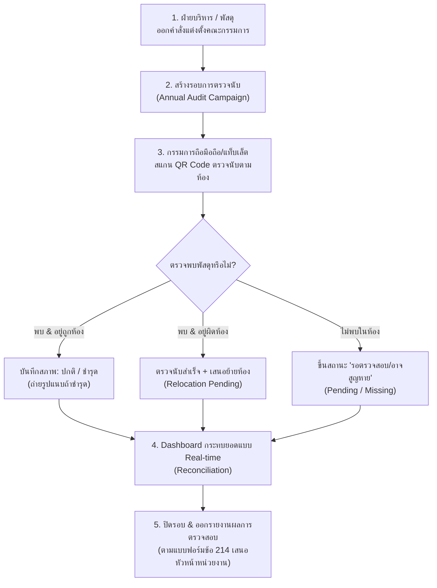

# Design Specification: CAMMS ระบบการตรวจนับพัสดุประจำปีตามระเบียบราชการ (Annual Physical Audit Workflow)

**สถานะ:** Proposed (พร้อมนำไปวางแผนพัฒนา)  
**วันที่:** 27 ตุลาคม 2569  
**เอกสารอ้างอิงทางกฎหมาย:** ระเบียบกระทรวงการคลังว่าด้วยการจัดซื้อจัดจ้างและการบริหารพัสดุภาครัฐ พ.ศ. 2560 (ข้อ 213 และข้อ 214)  
**หมวดหมู่:** Core Government Compliance & Lifecycle Management  

---

## 1. บทนำและปัญหาที่พบในงานราชการ (Background & Problem Statement)

### 1.1 บริบทตามระเบียบราชการไทย
ตามระเบียบกระทรวงการคลังว่าด้วยการจัดซื้อจัดจ้างและการบริหารพัสดุภาครัฐ พ.ศ. 2560:
- **ข้อ 213:** ก่อนสิ้นปีงบประมาณของทุกปี (ก่อน 30 กันยายน) ให้หัวหน้าหน่วยงานของรัฐแต่งตั้งเจ้าหน้าที่ในหน่วยงานที่ไม่ใช่เจ้าหน้าที่พัสดุคนหนึ่งหรือหลายคนเป็น **"คณะกรรมการตรวจสอบพัสดุประจำปี"** เพื่อทำการตรวจสอบการรับจ่ายพัสดุในงวด 1 ปีที่ผ่านมา และตรวจนับพัสดุคงเหลืออยู่ ณ วันสิ้นงวด
- **ข้อ 214:** ให้คณะกรรมการเริ่มตรวจสอบในวันเปิดทำการแรกของปีงบประมาณ (ตุลาคม) และรายงานผลการตรวจสอบต่อหัวหน้าหน่วยงานของรัฐภายใน **30 วันทำการ**

### 1.2 ปัญหาในทางปฏิบัติของหน่วยงานราชการ (Pain Points)
1. **การใช้กระดาษและคลิปบอร์ดเดินจด:** กรรมการต้องปริ้นท์ทะเบียนคุมพัสดุหนาหลายร้อยหน้า เดินตามห้องต่างๆ เสี่ยงต่อการกาผิดช่อง หรือกระดาษตกหล่น
2. **พัสดุย้ายห้องโดยไม่แจ้ง:** ครุภัณฑ์ถูกเคลื่อนย้ายระหว่างห้อง/กอง ทำให้หากรรมการหาของไม่พบ (ลงว่าสูญหาย ทั้งที่แค่เปลี่ยนห้องวาง)
3. **การกระทบยอด (Reconciliation) ใช้เวลานาน:** เจ้าหน้าที่พัสดุต้องนำกระดาษที่กรรมการกาไว้ มาคีย์ลง Excel ด้วยมือ ทำให้ปิดรายงานไม่ทันกรอบเวลา 30 วันทำการ
4. **หลักฐานไม่เพียงพอเมื่อของชำรุด:** ไม่มีการบันทึกภาพถ่ายสภาพครุภัณฑ์ ณ วันตรวจนับ ทำให้ยากต่อการเสนอขอจำหน่ายพัสดุตามข้อ 215

---

## 2. โครงสร้างกระบวนการทำงาน (End-to-End Workflow)



---

## 3. สถาปัตยกรรมข้อมูล (Database Schema Design)

โครงสร้างตารางใหม่บน PostgreSQL / Supabase ที่ต่อยอดจากตาราง `items` และ `locations` เดิมของ CAMMS:

```sql
-- 1. ตารางรอบการตรวจนับพัสดุประจำปี (เช่น ประจำปีงบประมาณ 2570)
CREATE TABLE public.annual_audit_campaigns (
    id UUID PRIMARY KEY DEFAULT gen_random_uuid(),
    fiscal_year INTEGER NOT NULL, -- เช่น 2570
    title TEXT NOT NULL, -- เช่น "การตรวจสอบพัสดุประจำปีงบประมาณ พ.ศ. 2570"
    order_number TEXT, -- เลขที่คำสั่งแต่งตั้ง เช่น "คำสั่ง สสจ. ที่ 123/2569"
    order_date DATE, -- วันที่ลงนามในคำสั่ง
    start_date DATE NOT NULL,
    due_date DATE NOT NULL, -- 30 วันทำการ
    status TEXT NOT NULL DEFAULT 'draft' CHECK (status IN ('draft', 'active', 'reconciling', 'completed', 'cancelled')),
    total_items_snapshot INTEGER DEFAULT 0,
    created_by UUID REFERENCES auth.users(id),
    created_at TIMESTAMPTZ DEFAULT NOW(),
    updated_at TIMESTAMPTZ DEFAULT NOW()
);

-- 2. รายชื่อคณะกรรมการตรวจสอบพัสดุประจำปี
CREATE TABLE public.annual_audit_committees (
    id UUID PRIMARY KEY DEFAULT gen_random_uuid(),
    campaign_id UUID NOT NULL REFERENCES public.annual_audit_campaigns(id) ON DELETE CASCADE,
    user_id UUID REFERENCES auth.users(id),
    full_name TEXT NOT NULL,
    position TEXT NOT NULL, -- ตำแหน่ง เช่น "นักวิชาการคอมพิวเตอร์ชำนาญการ"
    role TEXT NOT NULL CHECK (role IN ('chairperson', 'member', 'secretary')), -- ประธานกรรมการ / กรรมการ / เลขานุการ
    assigned_locations JSONB DEFAULT '[]'::jsonb, -- รายชื่อห้อง/อาคารที่สายนี้รับผิดชอบ
    created_at TIMESTAMPTZ DEFAULT NOW()
);

-- 3. ผลการตรวจนับรายชิ้น (Audit Item Entries)
CREATE TABLE public.annual_audit_entries (
    id UUID PRIMARY KEY DEFAULT gen_random_uuid(),
    campaign_id UUID NOT NULL REFERENCES public.annual_audit_campaigns(id) ON DELETE CASCADE,
    item_id UUID NOT NULL REFERENCES public.items(id),
    audited_by UUID REFERENCES auth.users(id),
    audited_at TIMESTAMPTZ DEFAULT NOW(),
    
    -- สถานะการตรวจพบ
    audit_status TEXT NOT NULL CHECK (audit_status IN ('present', 'missing', 'damaged', 'unusable', 'transferred', 'surplus')),
    -- present = พบปกติ, missing = ไม่พบ (สูญหาย), damaged = ชำรุดยังซ่อมได้, unusable = เสื่อมสภาพไม่คุ้มซ่อม, surplus = ของเกิน
    
    physical_condition TEXT CHECK (physical_condition IN ('good', 'fair', 'damaged', 'broken')),
    scanned_location_id UUID REFERENCES public.locations(id), -- ห้องที่ไปตรวจพบจริง
    expected_location_id UUID REFERENCES public.locations(id), -- ห้องเดิมตามทะเบียนคุม
    
    image_evidence_url TEXT, -- รูปถ่ายหลักฐานสภาพของพัสดุ (กรณีชำรุด หรือพบในสภาพทรุดโทรม)
    remarks TEXT, -- ความเห็นกรรมการ เช่น "จอแตกจากการใช้งานปกติ", "ถูกยืมไปใช้งานห้องประชุม"
    
    is_reconciled BOOLEAN DEFAULT FALSE,
    reconciled_notes TEXT,
    
    UNIQUE(campaign_id, item_id)
);

-- Index สำหรับค้นหาความคืบหน้ารวดเร็ว
CREATE INDEX idx_audit_entries_campaign ON public.annual_audit_entries(campaign_id, audit_status);
CREATE INDEX idx_audit_entries_location ON public.annual_audit_entries(scanned_location_id);
```

---

## 4. รายละเอียดหน้าจอและการใช้งาน (UI / UX Specifications)

### 4.1 หน้าจอแดชบอร์ดรอบการตรวจนับ (`/admin/annual-audits/[id]`)
- **Header:** แสดงชื่อปีงบประมาณ, วันสิ้นสุดกำหนด 30 วันทำการ (พร้อม Countdown Badge แสดงจำนวนวันที่เหลือ)
- **Key Metrics (บัตรสถิติ 4 ตัวหลัก):**
  1. **ความคืบหน้ารวม (%):** นับแล้วกี่รายการ จากทั้งหมดกี่รายการ
  2. **สภาพปกติ (Normal):** สีเขียว (Emerald)
  3. **ชำรุด/เสื่อมสภาพ (Damaged):** สีส้ม (Amber)
  4. **ยังไม่พบ/สูญหาย (Missing):** สีแดง (Rose)
- **ตัวกรองสถานะตามสถานที่ (Location Progress Tree):** แสดงว่าห้องไหนตรวจเสร็จแล้ว 100% ห้องไหนกำลังตรวจอยู่ เพื่อให้ประธานกรรมการติดตามงานได้

### 4.2 หน้าจอมือถือสำหรับกรรมการตรวจนับ (`/audit/session/[campaignId]`)
- **ออกแบบให้ใช้งานมือเดียวบนสมาร์ตโฟน/แท็บเล็ต:**
  - **โหมดเลือกห้อง (Location Filter):** เลือกห้องที่กำลังยืนอยู่ เช่น "ห้องประชุมชั้น 3"
  - **Camera Barcode/QR Scanner ทันใจ:** สแกนปุ๊บ มีเสียงติ๊ดสั้นๆ พร้อมสั่นตอบรับ (Haptic Feedback)
  - **Quick Action Buttons (ไม่ต้องพิมพ์):**
    - ปุ่มเขียว: `[ สภาพปกติ ครบถ้วน ]` (คลิกเดียวแล้วพร้อมสแกนตัวต่อไปทันที)
    - ปุ่มส้ม: `[ ชำรุด/ซ่อมได้ ]` ➔ เปิดกล้องถ่ายภาพแนบทันที
    - ปุ่มแดง: `[ เสื่อมสภาพ/จำหน่าย ]` ➔ แนบรูป + บันทึกเสนอจำหน่าย
  - **แจ้งเตือนหากของอยู่ผิดห้อง:** หากสแกนเจอของห้องอื่น จะขึ้นการ์ดสีฟ้าแจ้งเตือนว่า *"ของชิ้นนี้เดิมสังกัด ห้อง 201 ต้องการบันทึกย้ายมาห้องนี้เลยหรือไม่?"*
  - **Offline-First Resilience:** หากจุดตรวจนับเป็นห้องอับสัญญาณ (เช่น ชั้นใต้ดิน/โกดัง) ข้อมูลจะถูกเก็บใน IndexedDB/LocalStorage ชั่วคราว และ Sync กลับทันทีที่ได้รับสัญญาณเน็ต

### 4.3 หน้าจอเปรียบเทียบและกระทบยอด (Reconciliation Workspace)
- แสดงรายการปัญหาที่ต้องตัดสินใจ:
  - **พัสดุที่ไม่พบ (Missing Items):** รายการที่ยังไม่มีการสแกน สามารถกดฟังก์ชัน "ส่งแจ้งเตือนไปยังผู้ถือครองตามระเบียบ"
  - **พัสดุชำรุด/เสื่อมสภาพ (Write-off Candidates):** รวบรวมรายการที่กรรมการประเมินว่าชำรุด เพื่อส่งต่อเข้า **"กระบวนการจำหน่ายพัสดุ (Disposal Module)"** โดยไม่ต้องกรอกข้อมูลซ้ำ

---

## 5. การออกเอกสารรายงานตามระเบียบพัสดุภาครัฐ (Official Export Formats)

ระบบจะสร้างรายงานสำเร็จรูปที่พร้อมพิมพ์และลงลายมือชื่อได้ทันที:

1. **แบบรายงานผลการตรวจสอบพัสดุประจำปี (แบบฟอร์มตามระเบียบข้อ 214):**
   - หัวเอกสาร: บันทึกข้อความ เรียน หัวหน้าส่วนราชการ
   - ข้อความอ้างอิง: อ้างถึงคำสั่งแต่งตั้งคณะกรรมการตรวจสอบพัสดุ
   - ตารางสรุป: สรุปจำนวนและมูลค่าพัสดุที่คงเหลือ, ชำรุด, เสื่อมสภาพ, สูญหาย
   - ข้อเสนอแนะของคณะกรรมการ: ความเห็นเสนอซ่อมแซม, โอน, หรือจำหน่ายตามข้อ 215
   - ช่องลงลายมือชื่อ: ประธานกรรมการ, กรรมการ, เลขานุการ ครบถ้วน
2. **รายงานพัสดุชำรุดเสื่อมสภาพเพื่อขอจำหน่าย (แนบท้ายรายงาน):**
   - แสดงรูปถ่ายหลักฐาน, หมายเลขครุภัณฑ์, อายุการใช้งาน, มูลค่าตามบัญชี, และมูลค่าคงเหลือทางบัญชี
3. **ไฟล์สรุปกระทบยอดสำหรับฝ่ายบัญชี (Excel GFMIS Match):**
   - สำหรับส่งต่อให้ฝ่ายการเงินกระทบยอดกับระบบ New GFMIS Thai ประจำปีงบประมาณ

---

## 6. แผนงานการพัฒนาและลำดับความสำคัญ (Milestones)

| Phase | หัวข้องาน (Task) | ผลลัพธ์ที่ได้ (Deliverable) | ระยะเวลาประเมิน |
|:---:|---|---|:---:|
| **P1** | **Database & API Layer** | Migration สคริปต์ตาราง `annual_audit_*`, RLS Policies, Server Actions | 2-3 วัน |
| **P2** | **Admin Campaign Management** | หน้าสร้างรอบตรวจนับ, ตั้งกรรมการ, แดชบอร์ดสรุปเปอร์เซ็นต์ | 3-4 วัน |
| **P3** | **Mobile Scanner Interface** | หน้ารองรับการสแกน QR บนมือถือ, บันทึกสภาพ + ถ่ายรูป, Offline Sync | 4-5 วัน |
| **P4** | **Reconciliation & Export PDF** | หน้ากระทบยอดข้อผิดพลาด + สร้างเอกสาร PDF ทางการตามระเบียบข้อ 214 | 3-4 วัน |

---

## 7. กฎความปลอดภัยและข้อกำหนดพิเศษ (Design Constraints)
- **RBAC Strict Guard:** ผู้ที่มีสิทธิ์สแกนตรวจนับและแก้ไขผลในรอบนั้น จะต้องเป็นผู้ที่มีรายชื่อในตาราง `annual_audit_committees` หรือ `Admin` เท่านั้น (เพื่อป้องกันเจ้าหน้าที่พัสดุลงผลตรวจของตัวเองโดยไม่มีกรรมการรับรอง)
- **Data Freeze Snapshot:** เมื่อเริ่มรอบการตรวจนับ ระบบจะบันทึก Snapshot รายการสินทรัพย์ เพื่อป้องกันความคลาดเคลื่อนจากการตัด/เพิ่มพัสดุระหว่างการตรวจ
- **Thai Typography & Colors:** ฟอนต์ Sarabun สำหรับเนื้อหาภาษาไทย และปฏิบัติตามระบบสี Semantic Token ของ CAMMS อย่างเคร่งครัด
